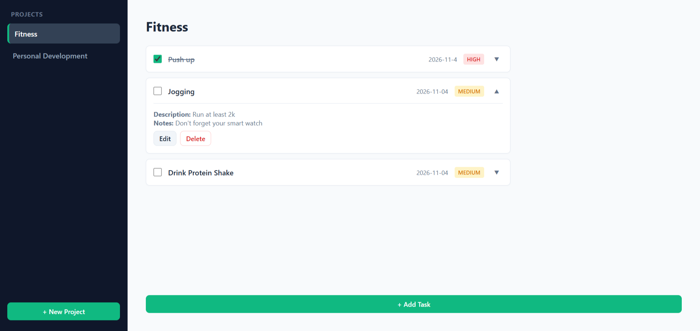

# 📋✨ Midnight & Emerald Todo List

A feature-rich, distraction-free task management application inspired by Todoist, built as part of The Odin Project curriculum. This project focuses heavily on advanced frontend data architecture—implementing factory functions, modular ES6 architecture, intelligent LocalStorage rehydration, Webpack bundling, and native HTML5 dialog modals—all wrapped in a sleek "Midnight & Emerald" personal productivity theme.

<p align="center">
  
</p>

---

## ✨ Features

- **Project & Task Management:** Group tasks into custom projects (e.g., *Inbox*, *Work*, *Fitness*) with full CRUD functionality for both projects and individual to-dos.
- **Persistent LocalStorage & Rehydration:** Automatically saves state to local storage and intelligently rehydrates plain JSON data back into fully functional JavaScript factory instances with methods intact.
- **Todoist-Inspired UI ("Midnight & Emerald"):** Styled with a deep slate-charcoal sidebar, crisp off-white viewports, soft card shadows, and vibrant emerald-green accent states.
- **Expandable Task Details & Editing:** Click to expand any task card to reveal detailed notes, due dates, priority tags, and clean inline editing workflows.
- **Accessible HTML5 Modals:** Utilizes native `<dialog>` elements with backdrop blurring for frictionless, professional task creation.
- **Safety Fallbacks:** Secure deletion workflows for tasks and projects with intelligent active-state re-routing.

---

## 🎨 UI Architecture & Blueprint

The interface utilizes a fixed sidebar layout coupled with a dynamic task viewport:

```
+-----------------------------------------------------------------------+
|  PROJECTS          |  INBOX                                           |
|--------------------|  [+ Add Task]                                    |
| > Inbox (Active)   |                                                  |
| > Work             |  +--------------------------------------------+  |
| > Grocery List     |  | [x] Refactor Webpack config    2026-06-01  |  |
|                    |  |     [Medium Priority]                  [▼] |  |
|                    |  +--------------------------------------------+  |
|                    |  | [ ] Write unit tests for storage module    |  |
|                    |  |     [High Priority]                    [▼] |  |
|                    |  +--------------------------------------------+  |
| [+ New Project]    |                                                  |
+-----------------------------------------------------------------------+
```
---

## 🚀 Live Demo

[👉 Click here to view the live deployment of the Todo List App!](https://villa116.github.io/odin-todo-list/)

---

## 🛠️ Technical Deep Dive

### LocalStorage & Factory Rehydration

Because `localStorage` strips methods during JSON serialization, the storage module deserializes raw data and rehydrates it back into full factory instances:

```
// src/storage.js
const loadProjects = () => {
  const storedData = localStorage.getItem(STORAGE_KEY);
  if (!storedData) return null;

  try {
    const parsedData = JSON.parse(storedData);
    return parsedData.map(projData => {
      const project = createProject(projData.name);
      projData.todos.forEach(todoData => {
        const todo = createTodo(
          todoData.title,
          todoData.description,
          todoData.dueDate,
          todoData.priority,
          todoData.notes,
          todoData.completed
        );
        project.addTodo(todo);
      });
      return project;
    });
  } catch (e) {
    console.error('Error loading from localStorage:', e);
    return null;
  }
};
```

---

## 🧱 CSS Styling & Midnight & Emerald Theme

Custom CSS variables establish the dark slate sidebar and vibrant emerald highlights.

```
:root {
  --bg-sidebar: #0f172a;       /* Deep slate */
  --sidebar-text: #94a3b8;
  --sidebar-hover: #1e293b;
  --sidebar-active: #334155;
  --accent-color: #10b981;     /* Vibrant Emerald */
  --accent-hover: #059669;
  --bg-main: #f8fafc;         /* Crisp off-white */
  --card-bg: #ffffff;
  --text-main: #1e293b;
  --border-color: #e2e8f0;
  --radius: 8px;
}

.project-item.active {
  background-color: var(--sidebar-active);
  color: #ffffff;
  font-weight: 600;
  border-left: 4px solid var(--accent-color);
}
```

---

## 📁 File Structure

```
odin-todo-list/
├── dist/                  # Production-ready compiled bundle output
├── src/
│   ├── appController.js   # Global state manager and coordination singleton
│   ├── domController.js   # UI rendering, event listeners, and modal manager
│   ├── index.js           # Main application entry point
│   ├── project.js         # Project factory function
│   ├── storage.js         # LocalStorage persistence & rehydration module
│   ├── style.css          # Midnight & Emerald theme & layout rulesets
│   ├── template.html      # HTML skeleton template for HtmlWebpackPlugin
│   └── todo.js            # Todo factory function
├── package.json           # Dependencies and project configurations
├── webpack.config.js      # Webpack development and build configuration
└── odin-todo-list-preview  # Project workspace preview capture resource
```

---

## 💻 Installation & Usage

1. Clone the repo
```
git clone https://github.com/Villa116/odin-todo-list.git
```

2. Enter the folder
```
cd odin-todo-list
```

3. Install dependencies
```
npm install
```

4. Run the development server
```
npm start
```

---

## 🧪 Technologies Used

- **HTML5:** Semantic markup, form controls, and native `<dialog>` modals.
- **CSS3:** Flexbox layouts, custom CSS variables, keyframe animations, and box shadows.
- **JavaScript (ES6+):** Factory functions, IIFE design patterns, ES modules (import/export), and closures.
- **Webpack 5:** Asset bundling, style/css loaders, HtmlWebpackPlugin, and live-reloading dev server.
- **Local Storage API:** Client-side data persistence and state caching.

---

## 🌟 Future Enhancements

- **Due Date Filtering:** Implement smart views such as "Today", "This Week", and "Overdue" tasks.
- **Drag-and-Drop Sorting:** Allow users to reorder tasks and projects seamlessly.
- **Dark Mode Toggle:** Add a full light/dark theme switch for the main content viewport.

Developed with ❤️ by Villa Bukasa